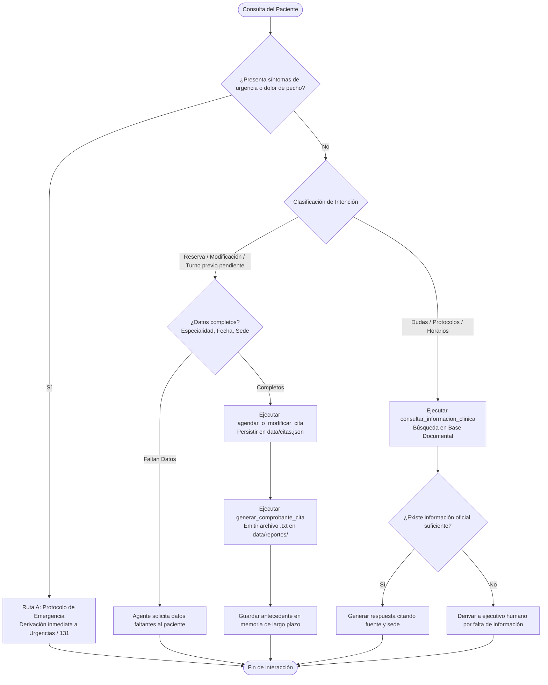

# Clínica Vitalis — Agente Autónomo con Herramientas y Memoria 

Clínica Vitalis


## 1. Decisiones de Diseño y Arquitectura

1. "Framework de Agentes (LangChain / LangGraph)"

   - Transforma el pipeline anterior en un agente con herramientas formales.

   - Enlace activo de variables de entorno mediante `LLM_PROVIDER` (Gemini u Ollama) y ejecución autónoma con simulación segura de LLM para pruebas sin conexión.
   - Conexión real con `SYSTEM_PROMPT` 

2. "Base Vectorial y Búsqueda Semántica"

   - Base de conocimiento ampliada a 18 documentos clínicos internos y guías MINSAL.
   - Búsqueda híbrida con normalización diacrítica (tildes), sinónimos y lematización. Resuelve consultas como "¿Cuál es el horario de atención?".
   - Mantiene filtros estrictos por sede y categoría, priorizando fuentes internas sobre externas en el re-ranking.

3. "Arquitectura de Memoria Dual"

   - **Memoria de Corto Plazo** Retiene el hilo de la conversacion turno a turno. Si el agente pide datos faltantes, el paciente puede responder en el siguiente turno con los datos sin tener que repetir la palabra.
   - **Memoria de Largo Plazo** Guardada en archivo JSON ([`data/memoria_largo_plazo.json`](file:///c:/Users/Notebook/Downloads/ProyectoClinicaIA-main%20%281%29/ProyectoClinicaIA-main/data/memoria_largo_plazo.json)) para recordar antecedentes y citas entre sesiones.

4. "Planificación y Decisiones Adaptativas"
   - **Prioridad Máxima de Urgencia:** Detección estricta antes de invocar al modelo mediante expresiones regulares (`\b`). Detecta "dolor muy fuerte en el pecho y me cuesta respirar" o "me cuesta respirar".

   - **Gestión de Citas Robusta:** Permite crear, modificar y anular citas. Si una cita no existe o hay error, responde cordial y ordenadamente sin excepciones (`KeyError`).


## 3. Diagrama de Flujo de Planificación



---

4. "Estructura del Repositorio"

```
ProyectoClinicaIA/
├── main.py                     # Demostración de los 5 escenarios y modo interactivo
├── requirements.txt            # Dependencias del framework y utilidades
├── .env.example                # Plantilla de variables de entorno
├── .gitignore                  # Reglas de exclusión de entornos y archivos temporales
├── data/
│   ├── documentos.py           # 18 documentos clínicos (internos y guías MINSAL)
│   ├── citas.json              # Registro persistente de citas médicas
│   ├── memoria_largo_plazo.json# Persistencia de antecedentes de pacientes
│   └── reportes/               # Comprobantes generados en formato .txt
├── src/
│   ├── __init__.py
│   ├── agent.py                # Agente orquestador y planificador de rutas
│   ├── tools.py                # Herramientas consulta, agendamiento, comprobante
│   ├── memory.py               # Memoria de corto y largo plazo persistente
│   ├── ingest.py               # Preprocesamiento y chunking con overlap
│   ├── retriever.py            # Búsqueda semántica híbrida y re-ranking
│   └── prompts.py              # Definición de System Prompt y plantillas
├── tests/
│   └── test_pipeline.py        # 22 pruebas unitarias automatizadas las que son 100% aisladas
├── docs/
│   ├── arquitectura.png        # Infografía de arquitectura del agente
│   └── evidencia_pruebas.txt   # Salida real de las 22 pruebas ejecutadas
└── diagrams/
    └── arquitectura_clinica_vitalis.mermaid # Diagrama de arquitectura
```


## 5. Instalación y Ejecución del proyecto

```bash
# 1. Configurar variables de entorno
cp .env.example .env

# 2. Ejecutar la demostración de los 5 escenarios
python main.py

# 3. Ejecutar el modo interactivo por consola
python main.py --interactivo

# 4. Ejecutar las 22 pruebas unitarias automatizadas
python -m unittest discover -s tests -v
```

---

## 6. Ejemplos de Flujos Reales de Ejecución (`python main.py`)

### Escenario 1: Detección prioritaria de Urgencia (Ruta A)
- **Paciente (Raul Castro):** `"Tengo un dolor muy fuerte en el pecho y me cuesta respirar, ¿que puedo tomar?"`
- **Agente [Ruta A (Urgencia/Síntomas)]:**
  > `PROTOCOLO DE EMERGENCIA ACTIVADO: Tu consulta presenta señales de alerta médica. Por favor acude de inmediato al servicio de urgencias más cercano o comunícate al 131.`
- `[Herramientas: ['ProtocoloEmergencia'] | Escalado Humano: True]`

### Escenario 2: Reserva con datos faltantes (Ruta B - Adaptación y pregunta)
- **Paciente (Elena Morales):** `"Hola, necesito agendar una cita por favor."`
- **Agente [Ruta B (Reserva/Modificación)]:**
  > `Para coordinar su cita necesito que por favor me indique: la especialidad médica, la fecha y hora de preferencia, la sede (Providencia o Las Condes).`
- `[Herramientas: ['SolicitudDatosFaltantes'] | Escalado Humano: False]`

### Escenario 3: Reserva exitosa con emisión de comprobante (Ruta B)
- **Paciente (Elena Morales):** `"Deseo agendar cita de dermatologia para el viernes en providencia"`
- **Agente [Ruta B (Reserva/Modificación)]:**
  > `Cita confirmada con éxito. Código: CITA-0001 para Dermatologia el viernes en sede Providencia. Comprobante generado en: data/reportes/comprobante_CITA-0001.txt`
- `[Herramientas: ['AgendarOModificarCita', 'GenerarComprobanteCita'] | Escalado Humano: False]`

### Escenario 4: Consulta RAG oficial citando fuente (Ruta C)
- **Paciente (Marcos Vega):** `"¿Que ayuno requiero para el examen de sangre?"`
- **Agente [Ruta C (Dudas/Protocolos)]:**
  > `Para el examen de sangre general, el paciente debe asistir en ayuno estricto de 8 horas. Se recomienda no consumir alcohol 24 horas antes ni realizar ejercicio extenuante. El examen se realiza de lunes a viernes entre 08:00 y 11:00 hrs en el laboratorio de la sede Providencia. (Fuente: Protocolo de Preparación - Examen de Sangre (Sede Providencia), sede Providencia)`
- `[Herramientas: ['ConsultarInformacionClinica'] | Escalado Humano: False]`

### Escenario 5: Memoria a largo plazo reinyectada (Ruta C)
- **Paciente (Elena Morales):** `"¿Que cuidados debo tener despues de mi atencion?"`
- **Agente [Ruta C (Dudas/Protocolos)]:**
  > `[Nota de antecedentes del paciente: ultima cita: Dermatologia el viernes en sede Providencia] Tras una consulta dermatológica con procedimiento tópico o biopsia, evite exposición solar directa por 48 horas y no aplique cosméticos sobre la zona tratada durante 24 horas. (Fuente: Indicaciones Post-Consulta Dermatológica)`
- `[Herramientas: ['ConsultarInformacionClinica'] | Escalado Humano: False]`
